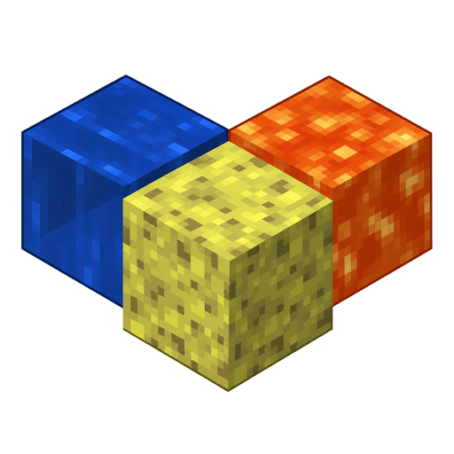
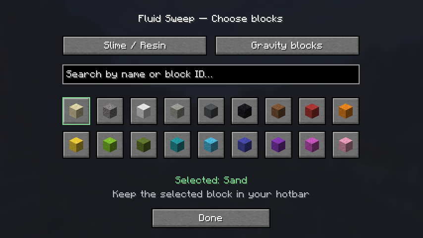

# Fluid Sweep

**Clear nearby water and lava sources using the blocks you choose.**

Fluid Sweep is a **client-side Fabric mod by XMasi**, available for Minecraft **1.21 through 26.3**.
Download the file that matches your exact Minecraft version.

## Features

- Replace water and lava source blocks with **slime or resin**. Resin is available on **1.21.4 and newer**; older versions offer slime.
- Control water, lava, gravity-water, and gravity-lava modes independently.
- Use **sand, gravel, or any of the 16 concrete powder colors** in gravity modes.
- Optionally mine slime and resin placed during the current world session. Resin uses normal mining time.
- Choose supported materials with a visual block picker and search by name or block ID.
- Searchable MaLiLib settings, reset buttons, configurable hotkeys, and optional Mod Menu integration.
- Import existing settings from `config/lavasponge.txt` on first launch.

## Install and use

1. Install Fabric Loader, **Fabric API**, and the **MaLiLib** release for your Minecraft version.
2. Download the matching Fluid Sweep JAR and place it in `mods`.
3. Remove the old Lava Sponge JAR if you are upgrading.
4. Press **F8** or open the settings through **Mod Menu**.
5. Put the selected blocks in your **hotbar** and enable the desired modes.

All modes default to off on a fresh installation. Imported Lava Sponge settings may already be enabled.
Settings are saved in `config/fluidsweep.json`.

The mod targets still water and lava blocks, excludes waterlogged builds, and respects normal block interaction reach.
It uses normal client interactions; servers validate placement and mining. Concrete powder hardens when touching water.
Gravity mode takes priority when both modes target the same fluid.
Cleanup only affects tracked slime/resin placed by this mod during the current world session; tracking clears on disconnect or world change.
On 26.x, block icons become available after joining a world; material selection still works from the main menu.

